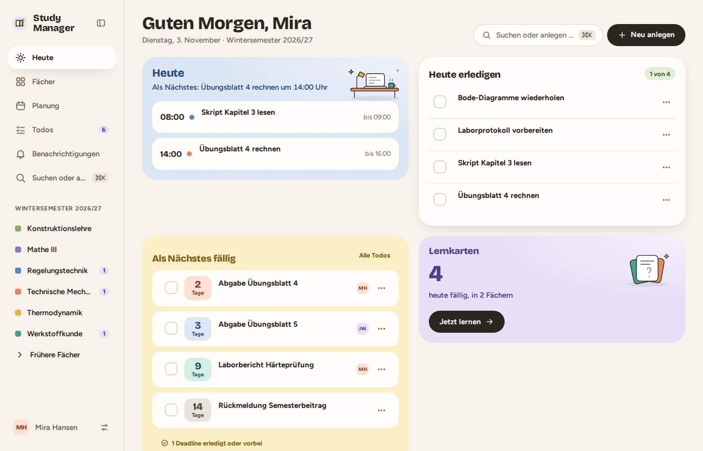

# Study Manager

**Your studies, comfortably sorted – together with your fellow students.**

Study Manager is a self-hosted web app for students: courses with lecture notes, exercises and past exams, shared deadlines, private tasks with scheduling, timetable subscriptions, shared notes next to the script, lecture transcripts, flashcards and a search. On top of that there is an MCP server through which **your own Claude** can work with all of it. The app itself runs no AI: what Claude should do is listed in a work inbox, which Claude fetches through MCP.

Free software under the [GPL-3.0](LICENSE). Made by students for students – and open to everyone who wants to contribute.

<p align="center">
  <picture>
    <source media="(prefers-color-scheme: dark)" srcset="apps/docs/static/img/oberflaeche/heute-dunkel.png">
    
  </picture>
</p>

## What it does

- **Courses** with roles (owner, editor, reader): documents, deadlines, members and an activity history, shared with your study group.
- **Deadlines and tasks**: shared deadlines in a course, everyone ticks them off for themselves; private tasks with day, time and duration as a time block in the calendar.
- **Planning**: week, day and month view, schedule tasks by dragging, calendar subscription (iCal) for your timetable and your phone.
- **Lecture mode**: scripts and notes in the whole window, as tabs, side by side, with zoom.
- **Notes** next to the script that follow the script page; shared or private.
- **Lectures** transcribed (Whisper in the browser or with your own key) and evaluated with Claude.
- **Flashcards** with spaced repetition, **search** in all documents (by meaning and wording).
- **Programmes and module handbook**: upload the module handbook as a PDF, Claude reads in the modules, courses are created from modules.
- **Your Claude** connects through MCP (Claude.ai, Claude Desktop, Claude Code) and works with your permissions.

The interface speaks **English and German** (each user picks theirs), semesters follow the German scheme (`WiSe`/`SoSe`), and the calendar subscription understands iCal feeds in the style of CAMPUSonline. Adaptations for other universities and languages are welcome (see below).

## Run it yourself

You need a server with Docker, a domain and a reverse proxy that handles HTTPS (for example Nginx Proxy Manager, Traefik or a Cloudflare Tunnel).

```sh
mkdir study-manager && cd study-manager
curl -fsSL https://github.com/erik1g/study-manager/releases/latest/download/study-manager.tar.gz | tar xz --strip-components=1
docker run --rm -e ADMIN_EMAIL=you@example.org -e DOMAIN=study.example.org \
  docker.io/erik1g/study-manager-server:$(cat VERSION) node /app/infra/scripts/setup.mjs --stdout > .env
docker compose up -d
docker compose logs server   # on the first start, the link to set up the admin account is here
```

You only download the small **operator package** (compose file, `update.sh`, database scripts) and the built images, **no source code**. Updates: `./update.sh 0.2.0`.

The app then listens on `127.0.0.1:8080`; your reverse proxy forwards your domain there. The full guide (proxy examples, backups, updates, mail) is in the **[admin documentation](https://erik1g.github.io/study-manager/admin)**.

## Documentation

**https://erik1g.github.io/study-manager/**

| For whom | What |
|---|---|
| [Users](https://erik1g.github.io/study-manager/users) | Courses, deadlines, planning, notes, lecture mode, connecting Claude |
| [Admins](https://erik1g.github.io/study-manager/admin) | Install, configure, backups, updates, security |
| [Developers](https://erik1g.github.io/study-manager/developers) | Architecture, running locally, tests, contributing, releases, design system |

## Contributing

Study Manager should work for **as many students as possible** – and for that we need you. You can report bugs, improve the documentation, connect your university (Stud.IP, HISinOne, ILIAS …), translate a language or build a feature. Beginner-friendly tasks carry the label [`good first issue`](https://github.com/erik1g/study-manager/labels/good%20first%20issue). Read [CONTRIBUTING.md](.github/CONTRIBUTING.md) first. The project language is English.

## Structure

| Part | Where |
|---|---|
| Web app (React, Vite) | `apps/web` |
| Server and MCP server (Node.js 24, TypeScript, Fastify, Drizzle, pg-boss) | `apps/server` |
| Building blocks and design ("Snug Simple") | `packages/ui` |
| Shared types | `packages/shared` |
| End-to-end tests (Playwright) | `apps/e2e` |
| Documentation (Docusaurus) | `apps/docs` |
| Containers, proxy, test data | `infra` |

Sign-in, passkeys and OAuth for MCP clients come from [Supabase Auth](https://github.com/supabase/auth) (GoTrue) on a PostgreSQL database of its own; both run in your Docker Compose project, not at Supabase.

## License

[GPL-3.0](LICENSE) – you may use, change and pass on Study Manager. Changed versions that you pass on must also be under the GPL.
